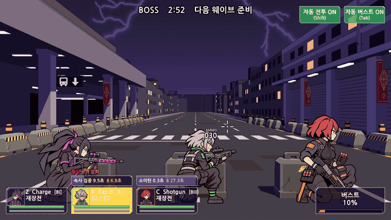
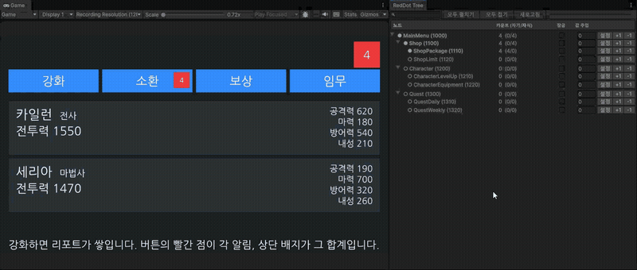
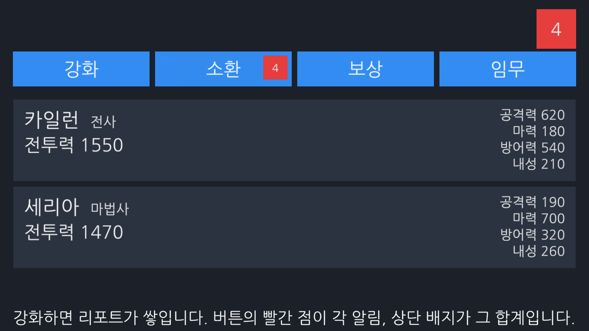
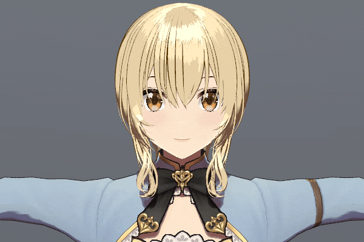
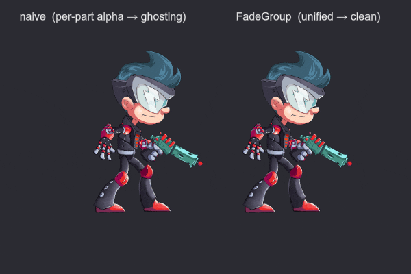
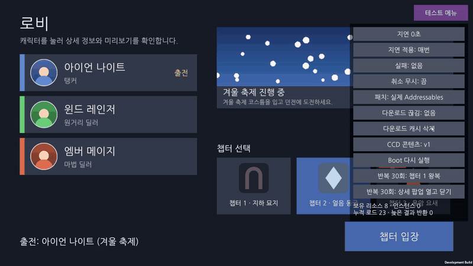

# 정휘현 - Unity Client Programmer

모바일 RPG의 UI와 핵심 콘텐츠 시스템을 설계하고 런칭부터 라이브 운영까지 맡아 온 Unity 클라이언트 프로그래머입니다.
경력 6년 9개월. 상점, 결제, 재화, 캐릭터 스탯, 던전 진입을 구현하고,
기획팀과 아트팀이 코드 수정 없이 콘텐츠를 다룰 수 있는 에디터 툴을 만들어 왔습니다.

silsen@naver.com, [GitHub](https://github.com/Frenil-client)

## 실무 경험

| 프로젝트 / 회사 | 담당 경험 |
|---|---|
| 아야카시 라이즈 / 클로버게임즈 | 가챠, 인벤토리, 캐릭터 육성 UI와 서버 연동, 결제 상품과 구매 흐름, 던전 진입, 스탯 합산과 캐시, 카메라와 조명 구조 |
| 트리 오브 세이비어M / IMC게임즈 | UI 콘텐츠, MVVM 바인딩, 재사용 스크롤, NGUI 셰이더 마스킹, Timeline과 Inspector 연출 툴 |
| 애프터타임 | 퍼즐, 전투 콘텐츠, Photon 멀티플레이, 플랫폼 서비스 연동과 공통 프레임워크 |

아래 저장소는 개인 작업물입니다. 실무에서 다룬 문제를 범용 시스템으로 재구현하거나,
런타임 제어와 렌더링 기법을 별도로 검증한 결과를 분야별로 묶었습니다.

## 분야별 저장소

| 분야 | 저장소 | 이 분야에서 볼 것 |
|---|---|---|
| [**대표 작업**](#대표-작업-aim-combat-slice) | [unity-aim-combat-slice](https://github.com/Frenil-client/unity-aim-combat-slice) | 조준 사격 전투 프로토타입. UI 스택, 스탯, Lobby Flow 배포 패키지를 가져와 썼습니다 |
| [**UI**](#ui) | [unity-ui-system](https://github.com/Frenil-client/unity-ui-system) [unity-mvvm](https://github.com/Frenil-client/unity-mvvm) [unity-reddot-system](https://github.com/Frenil-client/unity-reddot-system) [unity-integration-demo](https://github.com/Frenil-client/unity-integration-demo) | UI 스택과 정렬 구간, 데이터 바인딩, 알림 트리 집계를 게임 코드와 분리한 패키지, 그리고 세 패키지를 로비 화면 하나로 조립한 데모 |
| [**그래픽스**](#그래픽스) | [unity-urp-shader-lab](https://github.com/Frenil-client/unity-urp-shader-lab) [unity-spine-fx-lab](https://github.com/Frenil-client/unity-spine-fx-lab) [unity-maplightdata-tool](https://github.com/Frenil-client/unity-maplightdata-tool) | HLSL로 작성한 NPR 셰이더와 아트 파이프라인 툴, Spine 통합 페이드와 컬링 성능, 씬 조명 저장과 복원 |
| [**기타**](#기타) | [unity-lobby-flow](https://github.com/Frenil-client/unity-lobby-flow) [unity-stat-system](https://github.com/Frenil-client/unity-stat-system) | Addressables 원격 패치와 리소스 수명, Jenkins 빌드와 업로드 검증, 할당 없는 스탯 계산 |
| [**게임**](#게임-프로토타입) | [DefenceGame](https://github.com/Frenil-client/DefenceGame) [minigames](https://github.com/Frenil-client/minigames) | 순수 C# Core와 실시간 전투의 경계, Additive 미니게임 진입 구조 |

UI, MVVM, 스탯, 레드닷은 독립 UPM 패키지입니다. UI는 Unity 6000.3 이상,
나머지는 각 저장소에 적힌 Unity 최소 버전과 의존성을 따릅니다.

## 대표 작업: Aim Combat Slice

### [Aim Combat Slice](https://github.com/Frenil-client/unity-aim-combat-slice) - 조준 사격 전투 클라이언트 프로토타입

승리의 여신: 니케의 전투를 레퍼런스로, 엄폐 뒤에서 조준해 쏘는 3인 분대 전투 한 판을 만들었습니다.
무기 3종(연사, 차지, 산탄), 스킬과 단계형 버스트(I, II, III, 풀 버스트), 상태효과, 보스 부위 파괴와 패턴 저지,
히트스톱과 피격 플래시 같은 타격감을 넣었고, 캐릭터, 적, 배경, 이름은 모두 자체로 만들었습니다.

피해 계산과 상태효과는 UnityEngine을 참조하지 않는 Core 어셈블리에서 고정소수점과 결정적 난수로 처리합니다.
스킬은 발동 블록과 효과를 조합한 데이터 에셋이고, 스킬 관리 창이 실행 중 로드와 같은 규칙으로 검증한 뒤 저장합니다.
두 번째 스킬 세트(9종)는 코드 수정 없이 이 툴과 데이터만으로 추가했습니다.

씬마다 기초 리소스 목록을 두고 다음 씬이 쓰는 리소스만 남겨, 다시 시작할 때 새로 불러오는 리소스가 0개입니다.
화면 방향에 따라 기준 해상도를 돌리는 CanvasScaler 하위 클래스로 짧은 변을 1080에 맞추고 가로형과 세로형 배치를 바꿉니다.
버스트 컷인과 보스 등장 연출은 Timeline 에셋이 움직임을 정하고 코드는 그림, 글, 색만 넣습니다.

앞서 만든 패키지 세 개를 가져와 썼습니다.

| 가져온 패키지 | 이 프로젝트에서 쓴 곳 |
|---|---|
| [UI 스택](https://github.com/Frenil-client/unity-ui-system) | 전투 화면, 스킬 세트 선택, 결과 팝업과 공유 Dim. 프리팹 공급원 인터페이스에 Addressables 구현을 꽂아 팝업을 주소로 엽니다 |
| [스탯](https://github.com/Frenil-client/unity-stat-system) | 전투원 능력치. 공격력과 방어력을 기본값으로 두고 상태효과 합계를 모디파이어로 붙입니다 |
| [Lobby Flow](https://github.com/Frenil-client/unity-lobby-flow)의 배포 패키지 | Addressables 설정과 빌드 검사, 리소스 핸들 묶음, Jenkins 템플릿 |

**확인 방법:** 저장소의 [Release](https://github.com/Frenil-client/unity-aim-combat-slice/tree/main/Release) 폴더에 있는 Windows zip 또는 Android APK를 실행합니다.
에디터에서는 Unity 6000.3.9f1에서 `Assets/Scenes/Boot.unity`를 실행합니다.

| 자동 검증(Jenkins) | 별도로 확인한 범위 |
|---|---|
| 무결성 검사, Windows와 Android의 Addressables 빌드와 개발 빌드, 산출물 보관 | 에디터 자동 플레이로 가로, 세로 화면 한 판 승리까지 오류 0, 블루스택에서 APK 가로, 세로 플레이 |

Jenkins는 개발 PC에 설치해 실행 결과 페이지가 공개되어 있지 않습니다.
빌드 화면과 단계별 소요 시간은 [README의 빌드 자동화 절](https://github.com/Frenil-client/unity-aim-combat-slice#빌드-자동화jenkins)에 남겼습니다.

## UI

화면 수명과 정렬, 데이터 바인딩, 알림 집계를 게임 코드와 분리한 패키지들입니다.
아야카시 라이즈의 가챠, 인벤토리, 육성 UI와 트리 오브 세이비어M의 MVVM 바인딩, 재사용 스크롤을 다룬 경험을 범용 패키지로 다시 만들었습니다.

### [UI 스택 시스템](https://github.com/Frenil-client/unity-ui-system) - 게임에서 사용하는 UPM 패키지

레이어 캔버스, 정렬 순서 배정, 공유 Dim, 씬 소유권에 따른 UI 수명을 관리합니다.
뷰 타입이 레이어를 정하고, 뷰가 가진 캔버스 수만큼 정렬 구간을 예약했다가 닫을 때 반납합니다.
부트스트랩 설정을 갖추면 작업 중인 씬에서 바로 Play할 수 있습니다.

[DefenceGame](https://github.com/Frenil-client/DefenceGame)이 이 패키지를 UPM으로 설치해 사용합니다.
문자열 id로 팝업을 여는 호출을 `OpenAsync<ShopPopup>()`으로 바꿔 타입 이름 오타가 컴파일 단계에서 걸리고,
개별 backdrop은 공유 Dim 하나로 대체됩니다.
[Aim Combat Slice](#대표-작업-aim-combat-slice)는 프리팹 공급원 인터페이스에 Addressables 구현을 꽂아 팝업을 주소로 엽니다.

**확인 방법:** 패키지 저장소의 `SampleLobby` 씬 또는 DefenceGame의 상점, 조합, 결과 팝업.

### [MVVM](https://github.com/Frenil-client/unity-mvvm)과 [레드닷](https://github.com/Frenil-client/unity-reddot-system)

MVVM은 `Observable<T>`와, 목록 변경을 델타 이벤트 하나로 내는 `ObservableList<T>`로 바인딩합니다.
ViewModel은 MonoBehaviour가 아니라서 Unity 없이 테스트되고, View가 구독 수명을 책임집니다.

레드닷은 enum 숫자 구간에서 부모와 자식을 유도해 트리를 스스로 구성합니다.
자식 합계를 캐싱해 읽기는 O(1)이고, 갱신하면 바뀐 노드만 통지합니다. 콘텐츠가 잠긴 동안의 변화는 해제 시점에 한 번에 반영합니다.

트리 디버거는 카운트를 자기와 자식으로 분해해 표시하고, 값 주입, 잠금 토글, enum 계층 진단을 한 화면에 모았습니다.
표시 모델은 순수 C#이며 런타임과 같은 부모 계층 유도 함수를 사용합니다.

### [통합 데모](https://github.com/Frenil-client/unity-integration-demo) - 독립 패키지를 하나의 화면으로 연결

모바일 RPG 로비에서 능력치 강화, 소환, 보상 확인, 임무 수령이 동작합니다.
`stat-system`은 능력치와 변경 이벤트를, `mvvm`은 값과 목록 바인딩을,
`reddot-system`은 알림 집계를 담당합니다.

패키지 사이의 타입 변환은 소비 프로젝트의 `Glue/` 두 파일에 모았습니다.
각 패키지가 다른 패키지를 참조하지 않고, 도메인과 ViewModel은 Canvas나 GameObject 없이 테스트됩니다.
실제로 조립해 봐야 드러나는 것들은 데모가 아니라 패키지 쪽에 반영했고, 무엇이 왜 바뀌었는지는
[데모 README](https://github.com/Frenil-client/unity-integration-demo#이-데모가-드러낸-것)에 남겼습니다.

**확인 방법:** Unity 6000.3.9f1에서 `Assets/Scenes/LobbyDemo.unity` 실행.
EditMode 테스트 21종이 로비의 흐름을 검증하며, 설치 버전은 manifest의 태그로 고정합니다.

### UI 검증 범위

CI 구성 기준입니다. 최신 실행 결과는 각 워크플로에서 확인할 수 있습니다.

| 저장소 | 자동 검증 | Unity에서 별도로 확인할 범위 |
|---|---|---|
| [UI Validate](https://github.com/Frenil-client/unity-ui-system/actions/workflows/validate.yml) | 패키지 경계, meta, JSON, CHANGELOG 정합성. 릴리스 시 태그와 버전 대조 | EditMode, PlayMode 테스트, 씬 전환, 입력, 비동기 수명 동작 |
| [MVVM CI](https://github.com/Frenil-client/unity-mvvm/actions/workflows/ci.yml) | 순수 C# 코어 빌드, 헤드리스 20종, 할당 벤치마크 | View 테스트 15종과 Unity 할당 테스트 3종 |
| [RedDot CI](https://github.com/Frenil-client/unity-reddot-system/actions/workflows/ci.yml) | 코어 빌드, 트리와 진단 로직 47종 | Icon, Manager, EditorWindow의 Unity 동작 |

MVVM, 스탯, 레드닷의 헤드리스 테스트는 합계 124종입니다. `Tests~/`가 `Tests/`의 같은 소스를 컴파일하므로
사본이 아니라 같은 테스트가 매 푸시마다 우분투 러너에서 돕니다. 스탯은 [기타](#기타)에 있습니다.

## 그래픽스

셰이더를 직접 작성하고, 연출 값을 코드와 데이터로 제어하고, 씬 조명을 관리하는 작업입니다.
아야카시 라이즈의 카메라와 조명 구조, 트리 오브 세이비어M의 NGUI 셰이더 마스킹과 Timeline 연출 툴을 다룬 경험이 바탕입니다.

### [URP NPR 셰이더 랩](https://github.com/Frenil-client/unity-urp-shader-lab) - HLSL로 작성한 캐릭터 셰이더와 아트 파이프라인

자작 VRoid 모델 위에 캐릭터, 헤어, 눈, 얼굴 디테일 셰이더 4종을 Shader Graph 없이 HLSL로 작성했습니다.
얼굴 그림자는 노멀 대신 헤드 본 기준의 라이트 수평각을 SDF 임계값과 비교해, 고개가 기울어도 경계가 좌우 대칭으로 움직입니다.
하프톤, 뎁스 소벨 엣지, GT 톤매퍼 포스트 3종은 ScriptableRendererFeature로 구현했습니다.

셰이더와 함께 SDF 페이스 맵 베이커, 아웃라인 끊김을 막는 스무딩 노멀 베이커, 램프 생성기 등 에디터 툴 6종으로 아트 파이프라인을 갖췄습니다.
기본 MToon보다 확실히 나아지지 않는 기법은 넣지 않았고, 텍스처 저작에 달린 한계는 저장소 README의 알려진 한계 절에 적었습니다.

### [Spine FX 랩](https://github.com/Frenil-client/unity-spine-fx-lab) - 성능과 통합 투명 연출

Spine의 부위별 페이드에서 생기는 겹침을 RT 평탄화와 단일 알파 합성으로 처리하고,
화면 밖 캐릭터의 애니메이션과 메시 갱신 비용을 컬링으로 줄였습니다.

**측정 조건:** spineboy 300체 중 화면 안 60체를 갱신하고 240체를 컬링한 에디터 계측입니다.
컬링을 켜면 CPU 메인 프레임이 13.07ms에서 4.29ms로, 화면이 58 FPS에서 약 129 FPS로 바뀝니다. 드로우콜은 컬링 여부와 무관하게 77, 78로 같아,
절약은 그리는 양이 아니라 화면 밖 인스턴스의 갱신 비용에서 나옵니다.

MaterialPropertyBlock으로 인스턴스별 연출 값을 전달해 머티리얼 복제를 줄였습니다.
SRP Batcher 호환을 포기하는 대가와 해당 장면에서의 비교 계측은
[성능 분석](https://github.com/Frenil-client/unity-spine-fx-lab/blob/main/Docs/analysis/multi-instance-perf.md)에 정리했습니다.

### [MapLightData](https://github.com/Frenil-client/unity-maplightdata-tool) - 씬 조명 저장과 복원

렌더링 기법이 아니라 조명 데이터 관리 도구입니다. 실무에서 다룬 씬 조명 저장과 복원 문제를 바탕으로 새로 구현했습니다.
씬의 RenderSettings(Skybox, Ambient, Fog 등)를 ScriptableObject로 캡처하고,
Additive 씬을 열고 닫을 때 스택 최상단의 조명을 적용했다가 이전 조명으로 되돌립니다.
에디터 창에서 조명 에셋 생성과 Addressables 등록을 한 번에 처리합니다.

## 기타

UI와 그래픽스 밖의 클라이언트 시스템입니다. 리소스를 언제 받고 언제 놓는지, 콘텐츠를 앱 업데이트 없이 어떻게 바꾸는지,
플랫폼 빌드를 어떻게 재현하는지, 반복 계산에서 할당을 어떻게 없애는지를 다룹니다.

### [Lobby Flow](https://github.com/Frenil-client/unity-lobby-flow) - Addressables 원격 패치와 리소스 수명

로비까지 필요한 리소스는 로컬 그룹에, 시즌 코스튬과 챕터 2, 3은 Unity CCD의 원격 그룹에 둡니다.
앱을 다시 설치하지 않고 v1(겨울)에서 v2(봄)로 배너와 코스튬을 바꾸며, 시작할 때 카탈로그를 확인해 바뀐 번들만 받습니다.
캐릭터 미리보기는 요청마다 번호를 붙여 늦게 도착한 결과를 반환하고, 로비와 챕터 1을 30회 왕복해도 보유 리소스와 번들 수가 같습니다.

Jenkins `content-release`가 플랫폼마다 v1 전체 빌드부터 v2 업데이트, CCD 업로드, 공개 주소의 해시와 파일 검증까지 한 번에 처리합니다.
같은 커밋의 로컬 빌드와 Jenkins 빌드를 비교하며 공통 번들 이름, TMP 셰이더 디버그 정보, 폴더 항목의 의존성 기록 문제를 찾아 고쳤고,
중복 폰트와 셰이더를 분리해 챕터 2 다운로드를 약 2.9MB에서 21KB로 줄였습니다.

배포 설정, 빌드 창, 리소스 핸들 묶음, Jenkins 템플릿은 `com.frenil.addressables-delivery` 패키지로 분리해
[Aim Combat Slice](#대표-작업-aim-combat-slice)에서 다시 썼습니다.

**확인 방법:** Windows와 Unity 6000.3.9f1에서 로컬 콘텐츠 서버로 v1에서 v2로의 패치를 재현합니다. CCD 계정은 필요 없습니다.
[재현 절차](https://github.com/Frenil-client/unity-lobby-flow#직접-재현하기)

### [스탯 시스템](https://github.com/Frenil-client/unity-stat-system) - 할당 없는 능력치 계산

아야카시 라이즈에서 다룬 스탯 합산과 캐시를 범용 패키지로 다시 만들었습니다.
값은 long 고정소수점으로 저장하고, 기본값 위에 장비와 버프를 모디파이어로 붙였다 뗍니다.
뗄 때는 기본값부터 다시 계산해 값이 어긋나지 않고, 최종값은 쓰기 시점에 계산해 읽기는 배열 인덱싱 한 번입니다.
변경 통지는 실제로 저장된 최종값이 바뀔 때만 발행해, UI 바인딩이 연결되는 지점이 됩니다.

스탯 벤치마크는 .NET 8 / Release에서 대상 40만 연산의 관리 힙 할당이 0B인지 검사합니다.
스탯 저장은 long, 곱셈과 나눗셈의 중간 계산은 decimal이며, 같은 값과 같은 연산 순서를 전제로 합니다.

### 기타 검증 범위

| 저장소 | 자동 검증 | 별도로 확인할 범위 |
|---|---|---|
| Lobby Flow (Jenkins) | 무결성 검사, EditMode 45종, PlayMode 13종. 콘텐츠 릴리스에서 v1/v2 빌드, CCD 업로드, 공개 주소의 해시와 파일 크기 검증 | Windows와 Android 실행 화면. iOS는 검증 전 |
| [Stat CI](https://github.com/Frenil-client/unity-stat-system/actions/workflows/ci.yml) | 코어 빌드, 헤드리스 57종, 할당 벤치마크 | Unity 할당 테스트 6종, Mono와 IL2CPP 실행 확인 |

Lobby Flow의 Jenkins는 개발 PC에 설치해 실행 결과 페이지가 공개되어 있지 않습니다.
실행 번호별 결과와 CCD 해시는 [CCD 검증 기록](https://github.com/Frenil-client/unity-lobby-flow/blob/main/docs/records/2026-11-05-ccd-v1-v2.md)에 남겼습니다.

## 게임 프로토타입

### [DefenceGame](https://github.com/Frenil-client/DefenceGame) - SYNTHESIS (가칭)

랜덤 조합 디펜스의 그레이박스 프로토타입입니다. 현재 뽑기, 조합, 선택권의 흐름을 검증하고 있고,
배치 칸과 선택권으로 결정을 만듭니다. 팝업과 레이어는 [UI 스택](#ui) 패키지를 설치해 씁니다.

`Shared/Synthesis.Core`는 UnityEngine을 참조하지 않으며 코어 빌드, 테스트, CSV 불변식 린터를 CI에서 실행합니다.
맵 생성, 스폰, 루프 순회 등 Core의 처리는 시드와 정수 틱을 기준으로 재현됩니다.

### [MiniGames](https://github.com/Frenil-client/minigames) - Additive 미니게임 플랫폼

항상 상주하는 허브 씬 위에 미니게임 씬을 Additive로 열고 닫습니다.
미니게임은 `IMiniGame` 계약과 ScriptableObject 등록 데이터로 추가하며, 랜덤 디펜스와 타이밍 게임 2종이 들어 있습니다.

## 기술 스택

| 분야 | 기술 |
|---|---|
| UI | `UGUI` `NGUI` `MVVM` |
| 그래픽스 | `URP` `HLSL` `Spine` `Timeline` |
| 기타 | `Addressables` `Unity CCD` `Protobuf` `UniTask` `Jenkins` `GitHub Actions` |
| 공통 | `Unity` `C#` `ScriptableObject` `DOTween` |
